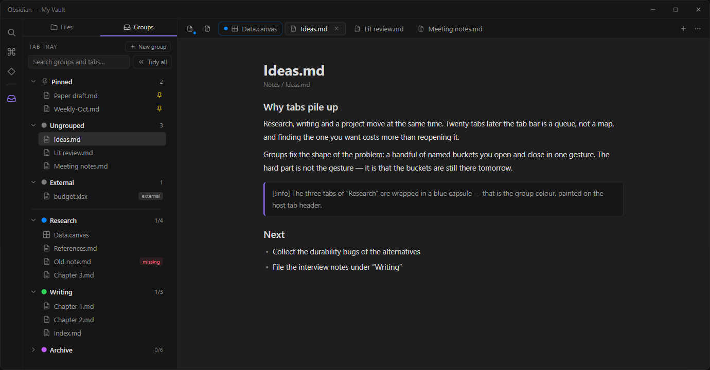
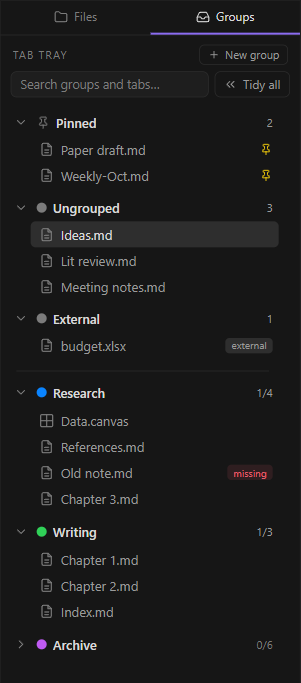

<div align="center">

# Tab Tray

**Browser-style tab groups for Obsidian desktop.**

Named, coloured groups you open and collapse in one click — plus a compact
pinned row. The point is not the grouping; it is that the groups are still
there tomorrow.

[](https://obsidian.md/plugins?id=tab-tray)
[](https://github.com/iceblyte/tab-tray/releases)
[](./LICENSE)

</div>



中文说明见 [README.zh-CN.md](./README.zh-CN.md)。

## Why another tab plugin

Research, writing and a project move at the same time. Twenty tabs later the tab
bar is a queue, not a map, and finding the one you want costs more than
reopening it.

Groups give it a shape: a handful of named buckets you open and close in one
gesture. The hard part was never the gesture — it is that the buckets are still
there tomorrow. Tab Tray is built around that: every mutation goes through one
validated path, writes are debounced and atomic, and a file that cannot be
parsed falls back to a backup instead of taking your groups with it.

## The panel



One list, not two modes. The panel opens with three derived sections — the tabs
you pinned, the tabs in no group, and the tabs opened from outside the vault —
then a rule, then your groups. The three sections are always drawn, even when
empty, so their counts are readable at a glance.

- **Pinned** — tabs you pinned in Obsidian. A pinned tab can never be a group
  member, so this section is where it lives.
- **Ungrouped** — open vault files that belong to no group yet. Drag one onto a
  group to file it.
- **External** — files opened from outside the vault. They have no durable
  vault path, so they are never grouped, never tinted and never counted.
- **Groups** — every persistent member, with an `n/m` counter that deduplicates
  across panes and windows.
- **Search** — matches a group name (the whole group is shown) or a file name.
- **Tidy all** — collapse every group in this window in one go.

<br clear="all">

## Open and collapse

Expanding a group replaces the tabs in the pane you are in, so a group is a
place you go rather than a pile you add to. Hold **Ctrl/Cmd** while expanding to
append instead. Collapsing closes the group's tabs in the current window only —
other windows, including popouts, are never touched.

Opening and closing are deliberately buttons: the two chevrons that appear on
hover. A click on the group row folds the list, which is what a row click looks
like it should do. Clicking a member focuses its tab if it is already open and
opens a new tab otherwise; it never replaces what you are reading.

## Pinned tabs

Pinned tabs shrink to icons at the start of the tab bar, with the native tooltip
intact and all three click behaviours unchanged. Because the plugin decorates
the host's own tab headers rather than rebuilding them, left, right and middle
click keep working.

Pinning is a membership-ending action: pin a member and it leaves the group,
with a notice saying where it went. Unpinning does not put it back — add it
again once it is a normal tab. Nothing about pin state is stored, so there is no
state to repair after a restart.

## Colour

Members of a group are tinted with that group's colour, drawn on the host's own
tab variables so the body, outline and the two bottom corner curves stay in
sync. Files outside a group are never tinted. The palette is ten fixed colours,
one light and one dark variant each, so it reads correctly in either theme.

## Your data


Groups live in `.obsidian/plugins/tab-tray/data.json`.

- Every change is written within about 500 ms using an atomic replace, after
  rotating the previous contents into `data.json.bak`.
- If the main file cannot be parsed, the backup is loaded instead and you are
  told. The unreadable file is renamed aside, never overwritten.
- If a sync tool leaves a conflict copy (`data.sync-conflict-*.json`), the
  newest parsable version wins and the conflict file is left alone.
- Disabling or uninstalling the plugin never deletes your data.
- No network requests, no telemetry. The plugin reads file paths and metadata
  only, never file contents.

Pin state and "missing file" markers are derived at runtime and deliberately
never written to disk, so they cannot go stale.

## Install

Tab Tray is in the community plugin store. Open **Settings → Community
plugins → Browse**, search for **Tab Tray** and install it — or open
[obsidian.md/plugins?id=tab-tray](https://obsidian.md/plugins?id=tab-tray)
directly.

To install by hand, for a vault that cannot reach the store:

1. Download `main.js`, `manifest.json` and `styles.css` from the
   [latest release](https://github.com/iceblyte/tab-tray/releases/latest).
2. Put them in `<your vault>/.obsidian/plugins/tab-tray/`.
3. Enable **Tab Tray** in Settings → Community plugins.

Obsidian desktop **1.14.0** or newer. Desktop only: the plugin works on the tab
bar and the workspace layout, which mobile does not have.

Release assets are built by GitHub Actions from the tagged commit and carry a
build provenance attestation:

```bash
gh attestation verify main.js --repo iceblyte/tab-tray
```

## Commands

| Command | What it does |
| --- | --- |
| New group | Create a group; it asks for a name and a colour |
| Open group sidebar | Reveal the panel, creating it in the left sidebar if needed |
| Collapse the active group's tabs | Collapse whichever group owns the file you are reading |
| Collapse all groups | Same as **Tidy all** in the panel |
| Open group: *name* | One per group, usable with the panel closed |
| Collapse group: *name* | One per group |

Everything is bound to no hotkey by default; assign them in Settings → Hotkeys.

## Development

```bash
npm install
npm run dev        # esbuild watch -> main.js
npm run build      # typecheck + production bundle
npm test           # Vitest, core and planning layers
npm run lint       # Biome
npm run typecheck  # tsc --noEmit
```

Architecture, the persistence design and the decision log are in
[docs/DESIGN.md](./docs/DESIGN.md); the requirement baseline is
[docs/PRD.md](./docs/PRD.md); the manual acceptance checklist is
[docs/ACCEPTANCE.md](./docs/ACCEPTANCE.md). The UI prototypes the implementation
follows are in [prototype/](./prototype/index.html), and the screenshots above
are rendered from the real `styles.css` by
[docs/images/build-preview.mjs](./docs/images/build-preview.mjs).

## Support

If Tab Tray saves you some tab wrangling, you can
[sponsor the author on Afdian](https://afdian.com/a/iceblyte).

## License

MIT
