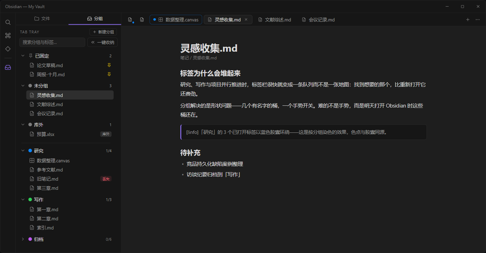
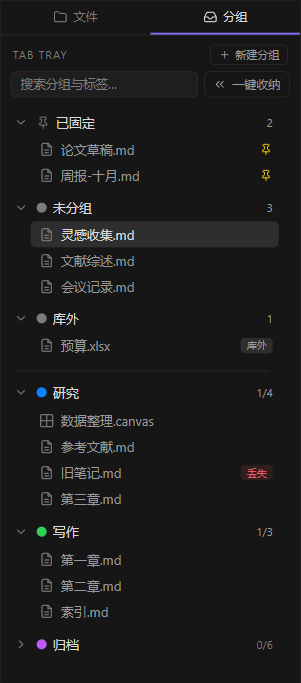
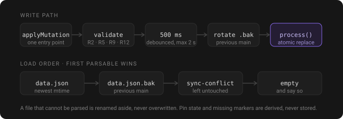

<div align="center">

# Tab Tray

**给 Obsidian 桌面端的浏览器式标签分组。**

分组有名、有色，一次点击就能展开或收起；另外还有一条紧凑固定行。重点不在「分组」本身，而在于明天重开 Obsidian 时，这些分组还在。

[](https://obsidian.md/plugins?id=tab-tray)
[](https://github.com/iceblyte/tab-tray/releases)
[](./LICENSE)

</div>



[English](./README.md) · 简体中文

## 为什么还要一个标签插件

研究、写作与项目常常并行推进。二十个标签之后，标签栏就不再是一张地图，而是一条队列——找到想要的那个，比重新打开它还费劲。

分组给的是形状：几个有名字的桶，一个手势开关。难的一直不是手势，而是明天打开 Obsidian 时这些桶还在。Tab Tray 就是围绕这一点做的——每次改动都走同一条校验路径，写盘防抖且原子，解析不了的文件会回退到备份，而不是把分组一起带走。

## 面板



只有一份列表，没有模式切换。面板打开时先是三个派生小节——你固定的标签、不属于任何分组的标签、从库外打开的文件——一条分隔线之后才是分组。三节**始终绘制**，即使为空也显示，所以一眼就能读出计数。

- **已固定** —— 在 Obsidian 里固定住的标签。固定标签永远不能是组员，所以它落在这里。
- **未分组** —— 已打开但还不属于任何分组的库内文件。把它拖到分组上即可归档。
- **库外** —— 从库外打开的文件。它们没有稳定的库内路径，因此不入组、不染色、也不计入 n/m。
- **分组** —— 全部持久成员，右侧 `n/m` 是跨窗格、跨窗口去重后的已打开数。
- **搜索** —— 匹配分组名（整组显示）或文件名。
- **一键收纳** —— 一次收起当前窗口内的所有分组。

<br clear="all">

## 展开与收起

展开分组会**替换**你当前所在窗格里的标签——分组是一个「去的地方」，而不是不断往里堆的东西。展开时按住 **Ctrl/Cmd** 则改为追加。收起只关闭**当前窗口**内该分组的标签，其它窗口（包括弹出窗口）一概不动。

打开和收起刻意做成按钮：悬停时出现的两个箭头。点击分组行只是折叠列表——这才是「点一行」看起来该有的行为。点击成员时，如果它已经打开就聚焦现有标签，否则新开一个；永远不会顶掉你正在读的那一页。

## 固定标签

固定标签会收缩成图标排在标签栏最左侧，原生 tooltip 保留，三种点击行为不变。插件是在宿主自己的标签头上做装饰，而不是重建标签，所以左键、右键、中键都还是原来的语义。

固定是一个「结束成员关系」的动作：固定一个组员，它立刻离开分组，并弹出一条说明它去哪了的提示。取消固定不会把它放回去——它变成普通标签后你再手动加一次。固定状态不落盘，所以重启之后没有需要修复的状态。

## 染色

分组成员所在的标签头会染上分组颜色。颜色写在宿主自己的标签变量上，所以主体、描边和底部两个圆角始终同源、同帧。不在分组里的文件永远不染色。色板是固定的十色，明暗主题各一套，因此两种主题下都读得清楚。

## 你的数据



分组数据保存在 `.obsidian/plugins/tab-tray/data.json`。

- 每次改动在约 500 ms 内以**原子替换**写入，写之前先把旧内容轮换进 `data.json.bak`。
- 主文件解析失败时改为加载备份并告诉你；那个读不出来的文件会被改名留存，**绝不覆盖**。
- 同步工具留下的冲突副本（`data.sync-conflict-*.json`）参与选举：修改时间最新的可解析版本获胜，冲突文件本身不动。
- 禁用或卸载插件**不会删除**数据。
- 不联网、不收集任何信息。插件只读文件路径与元数据，从不读文件内容。

固定状态与「文件丢失」标记都是运行时派生的，刻意不写盘，因此不会过期。

## 安装

Tab Tray 已上架社区插件市场。打开「设置 → 第三方插件 → 浏览」，搜索
**Tab Tray** 安装即可；也可以直接打开
[obsidian.md/plugins?id=tab-tray](https://obsidian.md/plugins?id=tab-tray)。

无法访问插件市场的库可以手动安装：

1. 从[最新 Release](https://github.com/iceblyte/tab-tray/releases/latest) 下载 `main.js`、`manifest.json`、`styles.css`。
2. 放进 `<你的库>/.obsidian/plugins/tab-tray/`。
3. 在「设置 → 第三方插件」里启用 **Tab Tray**。

需要 Obsidian 桌面版 **1.14.0** 或更高。仅桌面端：插件作用于标签栏与工作区布局，移动端没有这些结构。

发布资产由 GitHub Actions 从对应 tag 的源码构建，并附带构建来源证明：

```bash
gh attestation verify main.js --repo iceblyte/tab-tray
```

## 命令

| 命令 | 作用 |
| --- | --- |
| 新建分组 | 弹出对话框，填写名称并选择颜色 |
| 打开分组侧边栏 | 显示面板；左侧边栏没有就新建一个 |
| 收起当前分组的标签 | 收起「你正在读的文件」所属的那个分组 |
| 收起所有分组 | 等同面板里的「一键收纳」 |
| 展开分组：*名称* | 每个分组一条，面板关着也能用 |
| 收起分组：*名称* | 每个分组一条 |

默认都不绑定快捷键，可在「设置 → 快捷键」里自行分配。

## 开发

```bash
npm install
npm run dev        # esbuild watch -> main.js
npm run build      # 类型检查 + 生产构建
npm test           # Vitest，覆盖 core 与 plan 层
npm run lint       # Biome
npm run typecheck  # tsc --noEmit
```

架构、持久化设计与决策记录见 [docs/DESIGN.md](./docs/DESIGN.md)；需求基线见 [docs/PRD.md](./docs/PRD.md)；人工验收清单见 [docs/ACCEPTANCE.md](./docs/ACCEPTANCE.md)。实现所依据的 UI 原型在 [prototype/](./prototype/index.html)，上面的截图由真实 `styles.css` 经 [docs/images/build-preview.mjs](./docs/images/build-preview.mjs) 渲染而成。

## 支持

如果 Tab Tray 帮你省下了一些整理标签的时间，可以[在爱发电赞助作者](https://afdian.com/a/iceblyte)。

## 许可

MIT
